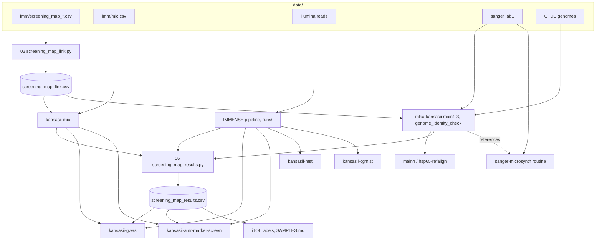

# Data flow between repos

Derived from `immensekansasii/scripts/run_downstream.sh` and `WORKFLOW.md` (run order). If they
disagree with this file, they win; update this file.

## Key files

| File | Produced by | Consumed by |
|---|---|---|
| `data/imm/screening_map_link.csv` | `immensekansasii/scripts/02_screening_map_link.py` | mic, mlsa, gwas, arm, mst, cgmlst |
| `data/imm/screening_map_results.csv` | `immensekansasii/scripts/06_screening_map_results.py` | gwas, arm (reannot), mlsa main4, iTOL, SAMPLES.md |
| `output/mic/{mhk,mgit}/` | `kansasii-mic/scripts/run_analysis.py` | results table, gwas, arm |
| `output/mlsa/main1..4/` | `mlsa-kansasii` sbatch programs | results table (`species_mlsa1/2`, `species_ref`), sanger-microsynth |
| `runs/<run>/` and `output/<run>/` | `run_IMMENSE.sh` | results table, gwas, arm, mst, cgmlst |
| `output/gwas/` | `kansasii-gwas/run_all.sbatch` | reports only |
| `output/arm/`, `output/arm_bam/` | `kansasii-amr-marker-screen/submit_arm*.sbatch` | reports only |

`screening_map_results.csv` has `NGS_USED` (after `NGS_MM`): the sequencing data used per isolate.
If `NGS_MM` was done it is used, not `NGS_JC`; `NGS_JC` only if there is no `NGS_MM` (Mkan329-001..133
= `NGS_MM`, 134..186 = `NGS_JC`). Mkan329-009 and -056 have both and use `NGS_MM`; their `-jc`
resequencing (run `mkan329_jc`) is not used. Copies: `data/imm/`, `output/`, `output/imm/`,
`output/iTOL/mkan329/` (06 only writes the first two; copy by hand).

The rows for mst, cgmlst and hsp65-refalign inputs were inferred from the repo summaries; check
each repo's README when relying on them.
