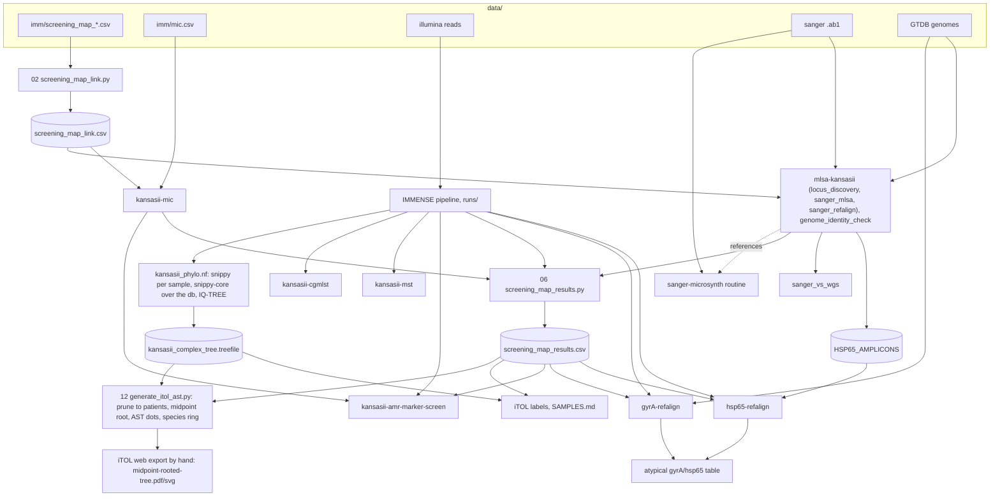

# Data flow between repos

Derived from `immensekansasii/scripts/run_downstream.sh` and `WORKFLOW.md` (run order). If they
disagree with this file, they win; update this file.

> **Ridom is the source of truth** for cgMLST/MST/clusters (2026-10-30, [RIDOM.md](RIDOM.md)). `kansasii-mst` and `kansasii-cgmlst` in the diagram are obsolete; only the Ridom input export and `sample_qc.tsv` are still used.

## Key files

| File | Produced by | Consumed by |
|---|---|---|
| `data/imm/screening_map_link.csv` | `immensekansasii/scripts/02_screening_map_link.py` | mic, mlsa, amr, mst, cgmlst |
| `data/imm/screening_map_results.csv` | `immensekansasii/scripts/06_screening_map_results.py` | amr (reannot), mlsa sanger_vs_wgs, hsp65-refalign, gyrA-refalign, iTOL, SAMPLES.md, mst, cgmlst (`excluded`) |
| `GTDB_REPRESENTATIVES` (`data/gtdb_genomes/.../kansasii_complex_gtdb_representatives/`) | `immensekansasii/scripts/03_run_gtdb_tree.sh` (links of the 7 type-strain genomes) | mlsa `09/10`, hsp65-refalign `01`, sanger-microsynth, cgmlst `00`, amr `03b` (flag `--gtdb-representatives` / `-g`) |
| `HSP65_AMPLICONS` (`.../kansasii_complex_hsp65_amplicons/`) | `mlsa-kansasii/scripts/06_make_hsp65_references.py` | hsp65-refalign `04/05`, mlsa `submit_hsp65_amplicon_alignment`, sanger-microsynth (flag `--hsp65-amplicons`) |
| `GYRA_REFERENCES` (`.../kansasii_complex_gyrA/`) | `gyrA-refalign/scripts/01` | gyrA-refalign `02/03` (flag `--gyra-references`) |
| `GTDB_COMPLEX_GENOMES` (`.../mlsa-kansasii/<species>/`) | `mlsa-kansasii/scripts/02_link_gtdb_kansasii_complex.sh` | mlsa `04/05/08`, gyrA-refalign `01` (flag `--complex-genomes`) |
| `output/kansasii-cgmlst/results/sample_qc.tsv` | `kansasii-cgmlst/scripts/07_summarise_scheme.py` | results table (`cgmlst_called_pct`, `excluded`) |
| `output/kansasii-mic/results/{mhk,mgit}/` | `kansasii-mic/submit_mic.sbatch` (`scripts/01_run_analysis.py`) | results table, amr |
| `output/mlsa-kansasii/results/<program>/` (locus_discovery, sanger_mlsa, sanger_refalign, sanger_vs_wgs, ...) | `mlsa-kansasii` `submit_*.sbatch` (`scripts/04-10`) | results table (`species_sanger_mlsa`/`species_sanger_mlsa_excl`, `species_ref`), sanger-microsynth |
| `runs/<run>/` and `output/<run>/` | `run_IMMENSE.sh` | results table, amr, mst, cgmlst (reads `runs/mkan329/assembly/results/` directly), hsp65/gyrA-refalign |
| `output/hsp65-refalign/results/`, `output/gyrA-refalign/results/{project,public}/` | hsp65-refalign, gyrA-refalign `submit_*.sbatch` | `kansasii-docs/bin/make_atypical_table.py` |
| `output/kansasii-docs/results/atypical_samples/` | `kansasii-docs/bin/make_atypical_table.py` | reports only (docs/ATYPICAL.md) |
| `data/imm/ridom-clusters.csv`, `ridom-comparison-table.csv` (+ further `ridom-*`, see RIDOM.md) | Ridom SeqSphere+ GUI export (manual) | `immensekansasii/scripts/06` (`ridom_*` columns); report |
| `data/imm/ridom-kansasii-plasmids.csv` | NCBI Genome export (manual) | docs/PLASMIDS.md only |
| `output/kansasii-ridom/ridom_assemblies.tar.gz`, `output/kansasii-ridom/ridom_assemblies.zip` (182 incl. M055) | `kansasii-ridom/scripts/01_export_ridom.py` (replaces `kansasii-cgmlst/scripts/10_export_ridom.py`, 181) | Ridom SeqSphere+ (manual) |
| snippy db `IMMense_dependencies/databases/kansasii_complex/<db>/<sample_id>/` (`/shares/sander.imm.uzh/software/pipelines/IMMense/`; `mkan329` has 186 samples) | `kansasii_snippy` (`immensekansasii/modules/kansasii_phylo.nf`), filled per sample; passed with `--kansasii_snippy_db` | `kansasii_snippy_core` (takes every usable sample dir of the db: the tree contains whatever is in the dir, minus empty samples and those below `--kansasii_min_aligned_fraction`) |
| `runs/<run>/<run>_transfer_result/kansasii_phylogeny/kansasii_complex_{core.aln,core.txt,core.samples.tsv,tree.treefile,tree.iqtree}` (`runs/mkan329`: 187 tips = 186 samples + `Reference`, 875 alignment columns because of six non-complex samples, see `WORKFLOW.md` 2d) | `kansasii_snippy_core` + `kansasii_tree` (core-SNP alignment, IQ-TREE GTR+G; unrooted, no support values), see `WORKFLOW.md` 2d | `07_generate_itol_species_labels.sh` (copy + labels in `output/immensekansasii/results/iTOL/<run>/`), `12_generate_itol_ast.py` |
| `output/immensekansasii/results/iTOL/mkan329_patients/{kansasii_patients_midpoint.nwk,itol_*.txt}` | `immensekansasii/scripts/12_generate_itol_ast.py` (prunes `mkan329` tree to the 171 patients, midpoint root, AST dots, species ring; input also `screening_map_results.csv`) | iTOL web (manual upload) |
| `data/imm/midpoint-rooted-tree.{pdf,svg}` | iTOL web export (manual) of the `mkan329_patients/` files above; copy in that directory | figure only, no script reads it |
| `output/immensekansasii/results/iTOL/mkan329_patients171/` (tree of the 171 clinical isolates alone, 287,242 core columns, with iTOL inputs; `README.md` in the dir) | one-off job of the 2026-11-09 review (`make_tree.sbatch` in the dir: `snippy-core` over the 171 sample dirs of the `mkan329` snippy db, IQ-TREE), then `12_generate_itol_ast.py --tree ... --out-dir ...` | iTOL web (manual): new basis for the tree figure, which is not redrawn yet |
| `output/kansasii-amr-marker-screen/results/assembly/`, `output/kansasii-amr-marker-screen/results/bam/` | `kansasii-amr-marker-screen/submit_amr*.sbatch` | reports only |

`screening_map_results.csv` has `NGS_USED` (after `NGS_MM`): the sequencing data used per isolate.
If `NGS_MM` was done it is used, not `NGS_JC`; `NGS_JC` only if there is no `NGS_MM` (Mkan329-001..133
= `NGS_MM`, 134..186 = `NGS_JC`). Mkan329-009 and -056 have both and use `NGS_MM`; their `-jc`
resequencing (run `mkan329_jc`) is not used. The canonical files are in `data/imm/` (`SCREENING_MAP_LINK`, `SCREENING_MAP_RESULTS`); scripts read only these. `output/` gets a copy
with a `<file>.MANIFEST.txt` from 02 and 06; `output/immensekansasii/results/imm/` and `output/immensekansasii/results/iTOL/mkan329/` hold older copies kept by hand (not read by any script).

`bash immensekansasii/scripts/run_downstream.sh` runs every row above except the pipeline and sanger-microsynth; the order of
its dependency chain is the order of this table.
